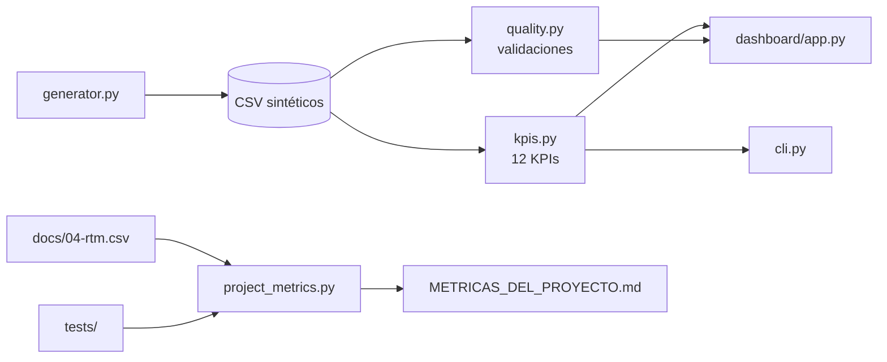

# 🧬 LabFlow KPI

[](https://github.com/priscilaInderkumer99/labflow-kpi/actions/workflows/ci.yml)


**Seguimiento de muestras y KPIs para un laboratorio de secuenciación, desde la recepción hasta el reporte.**
Proyecto de portafolio de *análisis funcional en bioinformática*: documentación de requerimientos trazada a código, pruebas y métricas.

> 📌 Los datos son **100 % sintéticos** y el laboratorio («GenoLab») es ficticio. Ver [Datos y registros de ejemplo](#datos-y-registros-de-ejemplo).

## El problema

GenoLab promete entregar cada reporte en 10 días, pero entre el 15 y el 20 % llega tarde y nadie sabe en qué etapa se pierde el tiempo. Las repeticiones, las fallas del pipeline y los huecos de custodia se descubren en las auditorías. Cada área mide «completado» a su manera.

**Este proyecto responde:** ¿dónde se va el tiempo?, ¿qué calidad tienen los datos con los que decidimos? y ¿cómo lo medimos de forma única y auditable?

## Qué incluye

- 🧪 **Generador de datos sintéticos** reproducible (semilla fija) del flujo de 7 etapas, con rechazos, repeticiones, fallas de pipeline y huecos de trazabilidad.
- 📊 **12 KPIs** con definición única, objetivo y semáforo (TAT, SLA, rechazo, repetición, QC, pipeline, backlog, custodia, metadatos, errores de reporte).
- ✅ **Validaciones de calidad de datos** (unicidad, integridad referencial, coherencia de fechas, etc.).
- 🖥️ **Dashboard** con una vista por persona (director, calidad, operaciones).
- 📑 **Documentación funcional completa**: business case, personas y procesos, historias de usuario con criterios Gherkin, matriz de trazabilidad (RTM), diccionario de KPIs, modelo de datos, plan de UAT, riesgos (FMEA), validación «lite» y ADRs.
- 🔁 **Trazabilidad verificada por CI**: si la RTM cita un test que no existe, el build falla.
- 📐 **Métricas del propio proyecto** (cobertura de trazabilidad, volatilidad, DDP, defect leakage, pass rate) calculadas automáticamente.

## Demo rápida

```bash
git clone https://github.com/priscilaInderkumer99/labflow-kpi.git
cd labflow-kpi
python -m venv .venv && source .venv/bin/activate      # en Windows: .venv\Scripts\activate
pip install -e ".[dev]"

make all          # genera datos → valida → KPIs → pruebas → métricas del proyecto
make dashboard    # abre el dashboard en http://localhost:8501
```

¿Sin `make`? Equivalentes: `python -m labflow.cli generate`, `... kpis`, `... validate`, `pytest`, `... project-metrics` y `streamlit run dashboard/app.py`.

Salida de `python -m labflow.cli kpis` (semilla 42):

```text
KPI-01  TAT mediana                         157.1 h  OK        (objetivo <= 168 h)
KPI-02  TAT p90                             287.2 h  ALERTA    (objetivo <= 240 h)
KPI-03  Cumplimiento de SLA                   84.3%  ALERTA    (objetivo >= 95%)
KPI-04  Tasa de rechazo                        3.0%  OK        (objetivo <= 5%)
KPI-05  Tasa de repetición                    12.0%  ALERTA    (objetivo <= 10%)
KPI-06  QC aprobado a la primera              95.3%  OK        (objetivo >= 92%)
KPI-07  Éxito del pipeline                    96.5%  ALERTA    (objetivo >= 97%)
KPI-08  Backlog total                  48.0 muestras  INFO      
KPI-09  Cadena de custodia completa           93.5%  ALERTA    (objetivo >= 100%)
KPI-10  Completitud de metadatos              99.4%  OK        (objetivo >= 98%)
KPI-11  Error de reportes                      0.9%  OK        (objetivo <= 1%)

Cuello de botella: REVISION
```

La lectura de negocio: **la revisión científica concentra ~42 % del tiempo total** y es la principal causa de incumplimiento del SLA; además, repetición, pipeline y custodia están fuera de objetivo. *(Es una demostración con parámetros declarados en [`config.py`](src/labflow/config.py), no un hallazgo real.)*

## Cómo está documentado (y qué demuestra)

| Documento | Qué demuestra |
|---|---|
| [01 · Business case](docs/01-business-case.md) | Definir problema, objetivos SMART, alcance, stakeholders y beneficios |
| [02 · Personas y procesos](docs/02-personas-y-procesos.md) | Modelado de procesos (AS-IS / TO-BE en BPMN-like), puntos de dolor, RACI |
| [03 · Historias de usuario](docs/03-requerimientos/historias-de-usuario.md) | Requerimientos con criterios de aceptación en Gherkin, priorizados con MoSCoW |
| [04 · RTM](docs/04-rtm.csv) | Trazabilidad requerimiento → KPI → test → UAT |
| [05 · Diccionario de KPIs](docs/05-diccionario-kpis.md) | Una definición, fórmula, dueño y umbral por KPI; reglas de cálculo |
| [06 · Modelo de datos](docs/06-modelo-de-datos.md) | ERD, diccionario de tablas y reglas de negocio |
| [07 · Plan de pruebas y UAT](docs/07-plan-de-pruebas-uat.md) | Estrategia de pruebas, criterios de go/no-go, casos de aceptación |
| [08 · Riesgos (FMEA)](docs/08-registro-de-riesgos.md) | Priorización por RPN con mitigaciones |
| [09 · Validación «lite»](docs/09-validacion-lite.md) | URS → FRS → OQ/PQ y ALCOA+ aplicados, con sus límites |
| [Control de cambios](docs/control-de-cambios.md) | Proceso de change request y su registro |
| [ADRs](docs/adr/) | Decisiones de diseño con contexto y consecuencias |

## KPIs

| ID | KPI | Objetivo |
|---|---|---|
| KPI-01 / 02 | TAT mediana / p90 | ≤ 168 h / ≤ 240 h |
| KPI-03 | Cumplimiento de SLA (240 h) | ≥ 95 % |
| KPI-04 | Tasa de rechazo | ≤ 5 % |
| KPI-05 | Tasa de repetición | ≤ 10 % |
| KPI-06 | QC aprobado a la primera | ≥ 92 % |
| KPI-07 | Éxito del pipeline | ≥ 97 % |
| KPI-08 | Backlog por etapa | informativo |
| KPI-09 | Cadena de custodia completa | 100 % |
| KPI-10 | Completitud de metadatos | ≥ 98 % |
| KPI-11 | Error de reportes | ≤ 1 % |
| KPI-12 | TAT por etapa y cuello de botella | vectorial |

Definiciones, fórmulas y reglas de cálculo: [diccionario de KPIs](docs/05-diccionario-kpis.md).

## Arquitectura



## Estructura del repositorio

```text
labflow-kpi/
├── docs/                    # documentación funcional (01 … 09), ADRs, registros
│   ├── 04-rtm.csv           # matriz de trazabilidad
│   └── registros/           # cambios.csv · defectos.csv
├── src/labflow/             # config · generator · kpis · quality · project_metrics · cli
├── dashboard/app.py         # Streamlit, una vista por persona
├── tests/                   # pytest: KPIs, calidad de datos, generador, dashboard, trazabilidad
├── .github/                 # CI, plantillas de issue y de pull request
├── CONTRIBUTING.md          # flujo de trabajo, DoR y DoD
└── CHANGELOG.md
```

## Métricas del propio proyecto

El repositorio aplica a sí mismo las métricas de un analista funcional. Se recalculan con `make metrics` y quedan en [`docs/METRICAS_DEL_PROYECTO.md`](docs/METRICAS_DEL_PROYECTO.md): cobertura de trazabilidad, volatilidad de requerimientos, DDP, defect leakage y pass rate de pruebas.

## Decisiones de diseño destacadas

- **El SLA no tiene sesgo de supervivencia**: las muestras abiertas ya vencidas cuentan como incumplidas ([ADR-0003](docs/adr/0003-sla-incluye-abiertas-vencidas.md)).
- **Cada fórmula se prueba con un dataset mínimo** de 5 muestras cuyos resultados se calculan a mano (`tests/conftest.py`).
- **La trazabilidad es ejecutable**: la RTM se valida contra los tests reales en cada build ([REQ-017](docs/03-requerimientos/historias-de-usuario.md)).
- **Privacidad por diseño**: solo seudónimos y una prueba que impide columnas de datos personales ([REQ-015](docs/03-requerimientos/historias-de-usuario.md)).

## Datos y registros de ejemplo

- Todos los datos de muestras se generan con [`generator.py`](src/labflow/generator.py); no hay información de pacientes reales.
- Los parámetros (duraciones, tasas de fallo) son **supuestos declarados**, no mediciones.
- Los registros de [`cambios.csv`](docs/registros/cambios.csv) y [`defectos.csv`](docs/registros/defectos.csv), y la columna *Resultado* del [plan de UAT](docs/07-plan-de-pruebas-uat.md), son **ejemplos ilustrativos** del proceso.

## Roadmap

- [x] **v0.1** · Business case, personas, historias, RTM inicial
- [x] **v0.5** · Generador, KPIs, validaciones y pruebas
- [x] **v0.8** · Dashboard por persona
- [ ] **v1.0** · UAT ejecutado y documentado, README con capturas, releases etiquetados
- [ ] **v2** · Exportación de custodia a CSV (REQ-019), conector a datos reales anonimizados, alertas

## Qué aprendí

_Completá esta sección al cerrar la v1.0: qué requerimiento cambió y por qué, qué defecto te enseñó más, qué harías distinto._

## Licencia

[MIT](LICENSE)
