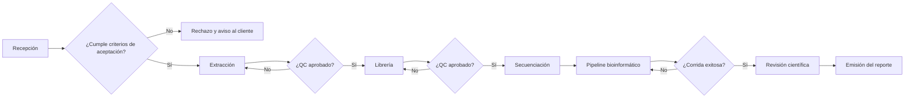
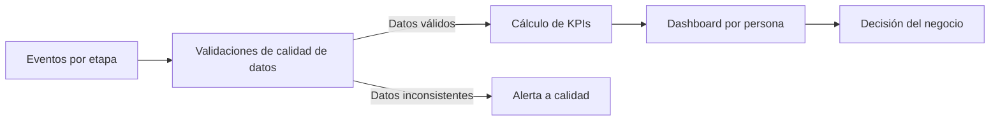

# 02 · Personas y procesos

## Personas

| Persona | Objetivo | Frustración actual | Vista del dashboard |
|---|---|---|---|
| **Laura, directora del laboratorio** | Entregar en plazo y justificar inversiones | No sabe dónde se pierde el tiempo | *Director del laboratorio* |
| **Marcos, responsable de calidad** | Llegar a la auditoría sin sorpresas | Descubre huecos de custodia tarde | *Responsable de calidad* |
| **Sofía, responsable de operaciones** | Balancear la carga entre etapas | Apaga incendios sin ver el cuello de botella | *Operaciones / Bioinformática* |
| **Diego, bioinformático** | Pipeline estable y reproducible | Las fallas del pipeline no se ven en el TAT | *Operaciones / Bioinformática* |

## Proceso actual (AS-IS) de la muestra

**Puntos de dolor identificados**

| # | Punto de dolor | Etapa | KPI que lo expone |
|---|---|---|---|
| P1 | Nadie mide cuánto tarda cada etapa | Todas | KPI-12 |
| P2 | Las repeticiones por QC no se contabilizan | Extracción / Librería | KPI-05, KPI-06 |
| P3 | Fallas del pipeline se resuelven «de palabra» | Pipeline | KPI-07 |
| P4 | Los traslados de muestras no siempre se registran | Etapas físicas | KPI-09 |
| P5 | Metadatos incompletos llegan al reporte | Recepción | KPI-10 |
| P6 | Reportes corregidos tras su emisión | Reporte | KPI-11 |

## Proceso futuro (TO-BE) con LabFlow KPI

## Matriz RACI (del proyecto)

| Actividad | Director | Calidad | Operaciones | Bioinformática | Analista funcional |
|---|---|---|---|---|---|
| Aprobar alcance y KPIs | **A** | C | C | I | R |
| Definir fórmulas y umbrales | A | R | R | C | **R** |
| Ejecutar UAT | I | **A/R** | R | R | C |
| Gestionar cambios | A | C | C | C | **R** |
| Aceptar la entrega | **A** | R | R | I | C |

*R: responsable · A: aprobador · C: consultado · I: informado.*
