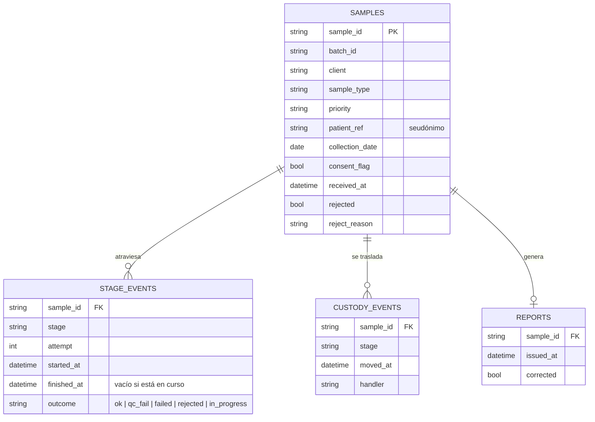

# 06 · Modelo de datos

## Diccionario de tablas

| Tabla | Granularidad | Clave | Notas |
|---|---|---|---|
| `samples` | una fila por muestra | `sample_id` | Metadatos obligatorios: `patient_ref`, `sample_type`, `collection_date`, `client`, `consent_flag` |
| `stage_events` | una fila por intento de etapa | `sample_id + stage + attempt` | `finished_at` vacío ⇒ etapa en curso |
| `custody_events` | una fila por traslado registrado | `sample_id + stage` | Solo etapas físicas: RECEPCION, EXTRACCION, LIBRERIA, SECUENCIACION |
| `reports` | una fila por reporte emitido | `sample_id` | `corrected` = se corrigió después de emitirse |

## Reglas de negocio

| ID | Regla | Validación |
|---|---|---|
| BR-01 | `sample_id` es único | `sample_id único` |
| BR-02 | Cada evento, traslado y reporte pertenece a una muestra existente | `integridad referencial` |
| BR-03 | Una etapa no puede terminar antes de empezar | `fin >= inicio en cada etapa` |
| BR-04 | Una muestra no está en dos etapas a la vez | `etapas sin solapamiento` |
| BR-05 | Un reporte no puede emitirse antes de la recepción | `reporte posterior a la recepción` |
| BR-06 | No hay fechas posteriores al corte | `sin fechas futuras` |
| BR-07 | Las etapas pertenecen al catálogo definido | `etapas válidas` |
| BR-08 | Metadatos obligatorios ≥ 98 % completos (advertencia) | `completitud de metadatos` |
| BR-09 | Solo se almacenan seudónimos | `test_generator_has_no_real_pii_columns` |
